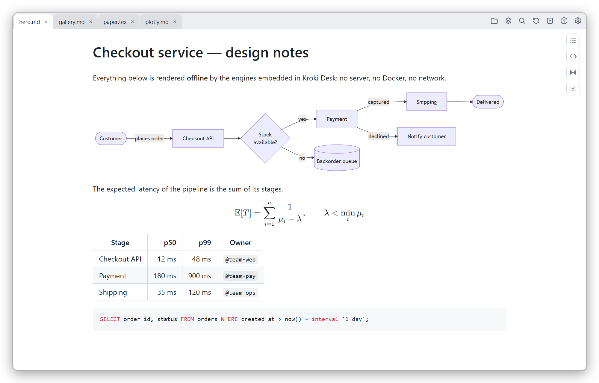
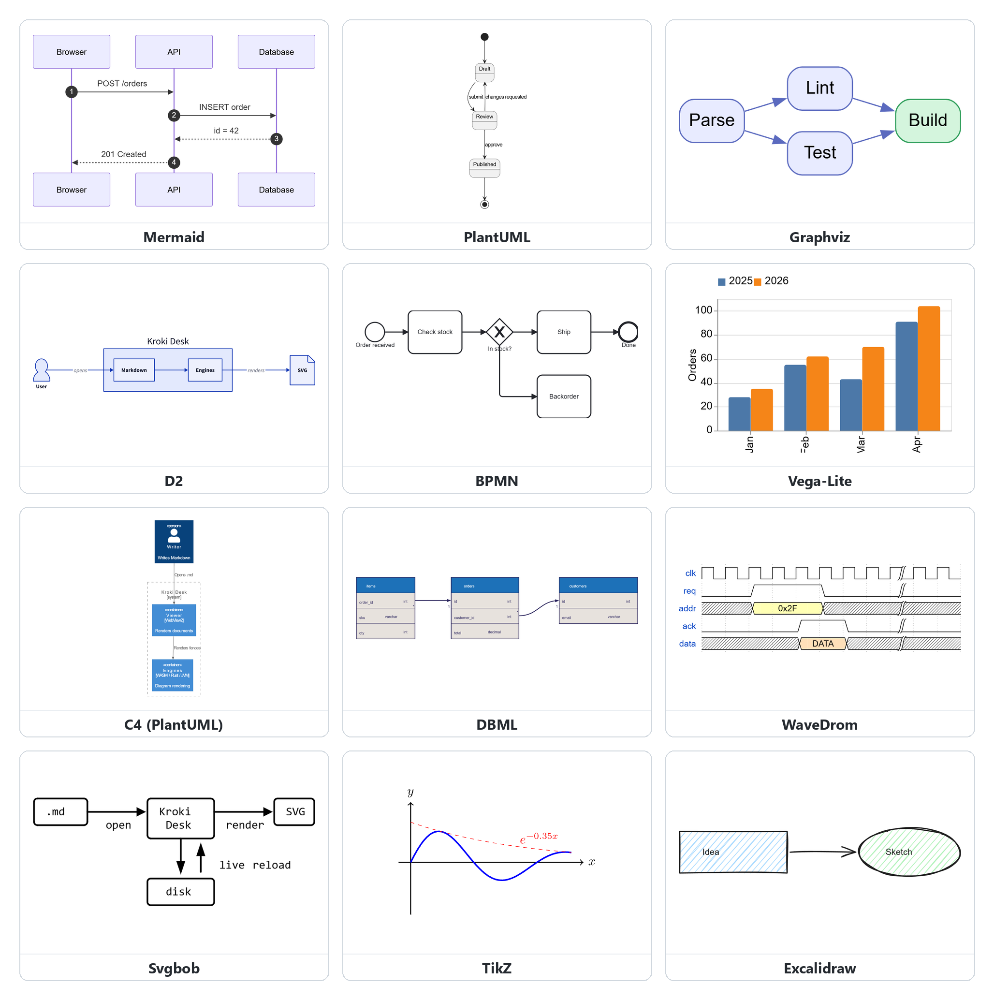
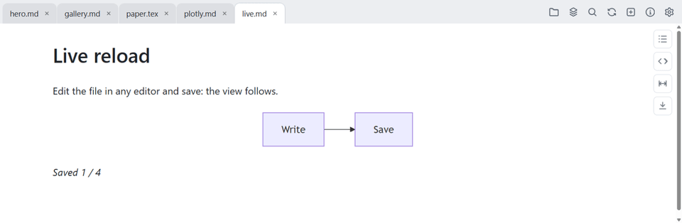
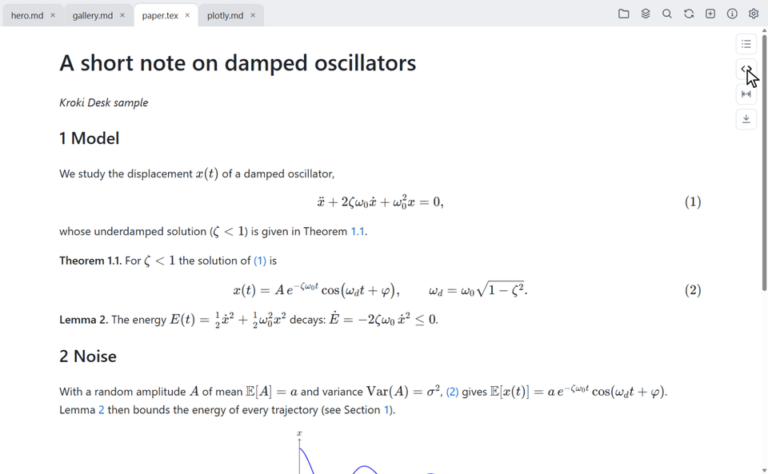
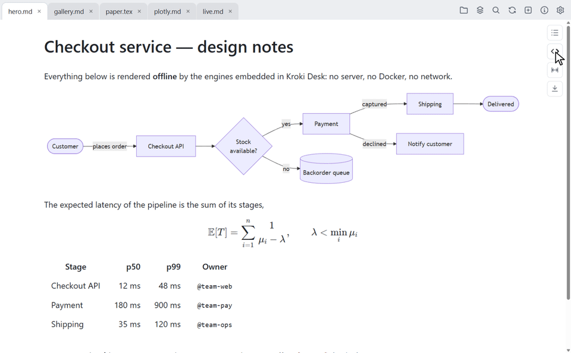
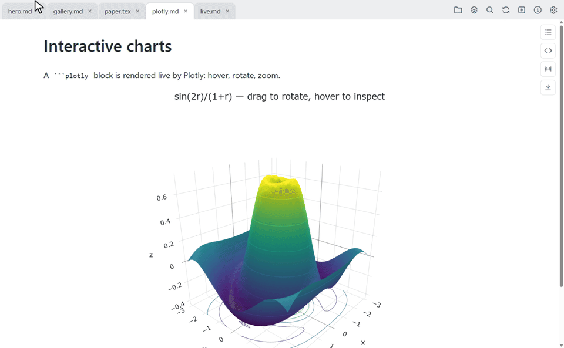
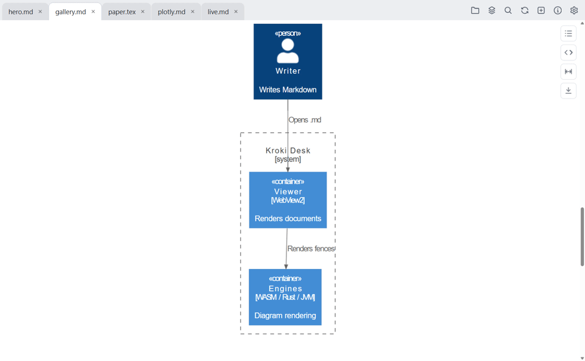

<div align="center">


# Kroki Desk

**A desktop Markdown viewer that draws your diagrams — offline.**

Mermaid, PlantUML, Graphviz, D2, BPMN, Vega, TikZ, Plotly… rendered to SVG by
engines **embedded in a single executable**: no server, no Docker, no network.


[](https://github.com/vdidon/kroki-deskapp/releases/latest)
[](LICENSE)

[**Download**](https://github.com/vdidon/kroki-deskapp/releases/latest) ·
[Engines](#diagrams-out-of-the-box) ·
[Tour](#a-quick-tour) ·
[Features](#all-features) ·
[Plugins](#plugins) ·
[Build](#build)

</div>

<picture>
  <source media="(prefers-color-scheme: dark)" srcset="doc/media/hero-dark.png">
  
</picture>

|  |  |
| --- | --- |
| 📦 **Self-contained** | One portable file (or an installer), engines inside, nothing sent over the network. Only PlantUML/ditaa (Java) and TikZ (TeX) use a runtime from the machine, when present. |
| 🧩 **18 diagram types built in** | Kroki syntax and aliases (` ```dot `, ` ```c4 `…): write once, render here, on a Kroki server or in VS Code. |
| 📐 **Math & LaTeX** | `$…$` / `$$…$$` via KaTeX, and whole `.tex` articles with numbered equations and clickable `\ref`s. |
| 🔁 **Live** | The view follows every save from your editor; Plotly charts stay interactive. |
| 🗂️ **Built for reading** | Tabs, tear-off windows, search across documents, source view, two kinds of zoom, HTML export, sessions. |
| 🔌 **Extensible** | Sandboxed plugins add formats (`.tex`, `.csv`…), fence types or syntax highlighting. |

## Installation

Grab the files from the [latest release](https://github.com/vdidon/kroki-deskapp/releases/latest):

| Platform | Portable | Installed |
| --- | --- | --- |
| Windows 10/11 | `kroki_deskapp-<version>.exe` | `kroki_deskapp-<version>.msi` |
| Linux x86_64 | `…-linux-x86_64-debian12.AppImage` | `…-linux-x86_64-debian12.deb` |

The portable binaries are a single file, with no installation and no admin
rights. The installers add a menu entry, a clean uninstall, the bundled
plugins and **file associations**: the two formats specific to Kroki Desk —
`.kdws` (session) and `.kdext` (plugin) — open on double-click, Kroki Desk is
added to "Open with" for the formats it reads natively (Markdown, HTML…), and
each installed plugin brings the associations for its own formats.

The `.deb` is installed with **apt**, which resolves dependencies (`dpkg -i`
does not):

```bash
sudo apt install ./kroki_deskapp-<version>-linux-x86_64-debian12.deb
```

Details — plugin selection in the MSI, silent installation, per-platform
associations, bare Linux binary: [doc/installation.md](doc/installation.md).

## Diagrams, out of the box

Write a fenced code block whose language is a diagram type — Kroki Desk renders
it in place. Syntax errors are shown in the document, where they happen.

<p align="center">
  
</p>

| Family | Types | Execution |
|---|---|---|
| JS / WASM | mermaid, graphviz (+`dot`), **d2**, **bpmn**, **excalidraw**, vega, vegalite, nomnoml, wavedrom, bytefield | dedicated invisible webview |
| JS → graphviz | **dbml**, **erd** (generate DOT, rendered by the embedded graphviz) | dedicated invisible webview |
| Native Rust | svgbob, pikchr | in-process |
| JVM | plantuml, c4plantuml (C4 stdlib included), ditaa | `plantuml-mit.jar` and `ditaa-standalone.jar` embedded, extracted and run **if Java is present** on the machine |
| TeX | **tikz** | compiled by the machine's TeX distribution (`latex` + `dvisvgm`, MiKTeX or TeX Live) **if present** — nothing is embedded |
| JS "live" | **plotly** (interactive charts) | in the displayed view, no frozen SVG |

Accepted aliases: ` ```dot ` → graphviz, ` ```c4 ` → c4plantuml,
` ```vega-lite ` → vegalite, ` ```puml ` → plantuml…

<details>
<summary>Types that are not embedded, and engine notes</summary>

Kroki types **not** embedded — they depend on a Python runtime
(blockdiag/seqdiag/actdiag/nwdiag/rackdiag/packetdiag, wireviz, symbolator), or
have no usable port (structurizr, umlet,
diagramsnet): an explicit message is displayed; an **external Kroki
server** can be configured in the settings (⚙) to cover them — it then
handles all renderings.

> **excalidraw**: rendered via `@excalidraw/excalidraw` (`exportToSvg`). The
> handwriting fonts (Excalifont, ~14 MB) are **not** embedded, to keep the binary
> reasonably sized; text is rendered with a system font (readable, not handwritten).

> **plotly**: the only **interactive** engine (hover, zoom, pan). Unlike
> Kroki diagrams rendered as frozen SVG, it runs in the displayed view. A
> ` ```plotly ` block contains either an inline Plotly JSON spec (`{data, layout}`)
> or `src=path.json` (read relative to the document) to keep the `.md` light. The
> `vendor/plotly.min.js` bundle (~4.8 MB) is loaded on demand, at the first
> figure encountered.

</details>

## A quick tour

### Live reload

Keep your editor on one side, Kroki Desk on the other: every save re-renders
the document, diagrams included.

<p align="center"></p>

### LaTeX documents, with working cross-references

Open a standalone `.tex` article like any document (`latex-doc` plugin,
installed by default): numbered sections and equations, `amsthm` theorems,
preamble macros expanded, TikZ figures — and **`\ref`/`\eqref` you can click**.
The `</>` button shows the colored source at the same position.

<p align="center"></p>

### Search every open document at once

`Ctrl+Shift+F` searches the source of all tabs; results are grouped by
document with line numbers, and a click jumps to the occurrence. `Ctrl+F`
searches the displayed document. Both offer match case, whole word and regex.

<p align="center"></p>

### Interactive charts

A ` ```plotly ` block stays alive: hover for values, drag to rotate, scroll to
zoom.

<p align="center"></p>

### Page zoom for dense figures

`Shift+wheel` zooms the whole page around the cursor, without reflowing it —
pan across a figure too dense to fit on one screen. `Ctrl+0` resets.

<p align="center"></p>

## All features

<details>
<summary><b>Reading</b> — Markdown, math, LaTeX, source view, HTML files</summary>

- **Markdown rendering** in GitHub style (tables, task lists, syntax highlighting,
  heading anchors, relative links between `.md` files, local images).
- **LaTeX math** inline (`$…$`) and in blocks (`$$…$$`), rendered by the
  embedded KaTeX (fonts included, no network).
- **Built-in diagrams** with Kroki syntax (see [above](#diagrams-out-of-the-box));
  syntax errors are displayed in the document.
- **LaTeX documents (`.tex`)** — via the `latex-doc` plugin: a standalone
  LaTeX article opens like a regular document. Numbered sections feeding the
  table of contents, formulas rendered by KaTeX, numbered equations, `amsthm`
  theorems (including shared counters), **clickable `\ref`/`\eqref`
  cross-references**, preamble `\newcommand` macros expanded, tables and lists.
  A ` ```latex ` fence in a `.md` gets the same rendering. The rendering is
  semantic: LaTeX page layout (pagination, floats, columns) is not
  reproduced, and multi-file documents (`\input`) and bibliographies are not
  supported. TikZ figures are drawn if a TeX distribution is installed on the
  machine (see the `tikz` engine).
- **Source view** (`</>`, view action stack): the file as it is on disk,
  numbered and **colored** — Markdown, `.tex`/`.latex`, and the formats of
  plugins that provide a grammar; a format without a grammar is shown as plain
  text. Toggling preview ↔ source keeps the reading position.
- **Automatic reload** when the file changes on disk.
- **`.html`/`.htm` files** (including the app's own exports) open in a tab: the
  page is displayed as is, through a sandboxed iframe (no script executed).

</details>

<details>
<summary><b>Tabs & windows</b> — tear-off tabs, drag and drop, sessions</summary>

- **Tabs**: several files per window, reorderable with the mouse, closed with
  a middle click or `Ctrl+W`.
- **Multi-window**: `Ctrl+Shift+N`, or by **detaching a tab** — drag a tab out
  of the bar to move it into its own window, drop it onto another window of the
  application to reattach it (like a browser).
  Detaching by dragging is Windows-only; on Linux, tabs can be reordered within
  their window.
- **Drag and drop** of files from the file manager (and, on Windows, from an
  editor such as VS Code).
- **`.kdws` sessions**: the "stack" button in the tab bar saves the current
  state (all windows, tabs in order, active tab) to a portable JSON file;
  reopening it (drag-drop, Open dialog, CLI, or double-click — the installer
  associates `.kdws` with the application) restores everything — the first
  window of the session in the target window, the following ones in new
  windows. Relative paths are resolved from the `.kdws` folder (`/` separator,
  hand-editable, committable next to the documents); missing files are skipped
  and reported. The application never restores anything automatically at
  startup: reopening a session is always an explicit action.

</details>

<details>
<summary><b>Search</b> — in the document, across documents, options</summary>

- **Search in the document** (`Ctrl+F`): compact bar in the top-right corner of
  the reading area — `n/m` counter, previous / next occurrence (`Enter`,
  `Shift+Enter`, `F3`), close. All occurrences are highlighted, the current one
  in a contrasting shade. The search covers what is displayed: it follows the
  current mode (preview, source, intermediate markdown).
- **Search across all open documents**: the magnifier in the tab bar
  (or `Ctrl+Shift+F`) searches the typed text in the source of every tab;
  results are grouped by document with line number and excerpt, and a click
  activates the tab, scrolls to the line and highlights the occurrences in the
  view.
- **Search options**, shared by both: `Aa` match case, `ab` whole word, `.*`
  regular expression — attached to the right of the field, as in an editor.
  "Whole word" recognizes accented letters (`été`, `naïve`); an invalid pattern
  turns the field red.

</details>

<details>
<summary><b>Zoom & export</b></summary>

- **Text zoom**: `Ctrl+wheel`, `Ctrl+=` / `Ctrl+-` — the text grows and
  reflows within the column, a full-width figure keeps its size.
- **Page zoom**: `Shift+wheel`, around the cursor — true zoom, no reflow:
  everything grows, the page overflows into horizontal scrolling, which lets
  you pan across a figure too dense to fit on one screen.
  `Ctrl+0` resets both zooms to 1.
- **HTML export**: the download arrow (view action stack) saves the rendering
  of the active tab as a standalone HTML page — inlined styles, diagrams as
  SVG, local images as data URIs — viewable in any browser, without the
  application or a network.

</details>

<details>
<summary><b>Command line & local Kroki API</b> — for scripts, editors and agents</summary>

- **CLI**: `kroki_deskapp "file.md" ["other.md" …]` — single instance:
  subsequent invocations open the files in the first window.
  A file can carry a **reference**, using link syntax:
  `"modele.tex#eq:sigmaU"` (`\label`), `"doc.md#section"`, `"doc.md#L42"`
  (source line) — the document opens and scrolls to it. A file name that itself
  contains `#` remains openable: the whole argument is tried as a path before
  being split at the last `#`. **`-d`** (`--detach`) relaunches the
  application detached from the terminal and returns immediately:
  `kroki_deskapp -d "doc#ref"` from bash (Git Bash, Linux), which otherwise
  would only return when the application is closed if it was not already
  open. Once installed, the application is launched by name without touching
  the PATH (`start ""`/`Start-Process` on Windows, `/usr/bin` on Linux — see
  [installation](doc/installation.md#launching-by-name)).
- **Local Kroki API** (optional, enabled by default on
  `http://127.0.0.1:8442`): exposes the built-in rendering to third-party
  tools — VS Code extensions, scripts… Routes: `POST /` (JSON), `POST /{type}/svg`
  (plain text), `GET /{type}/svg/{deflate+base64url}`, `GET /health` and
  `GET /v1/health` (Kroki compat: `{"status":"pass","version":{…}}`, read by
  the `markdown-kroki` extension on activation to learn which types are rendered).

  ```bash
  curl -s http://127.0.0.1:8442/graphviz/svg --data 'digraph { a -> b }' > out.svg
  ```

</details>

## Shortcuts

The same list is shown on the application's welcome screen (window with no
open tab).

| Shortcut | Action |
|---|---|
| `Ctrl+O` | Open a file |
| `Ctrl+W` | Close the tab (then the window if no tab is left) |
| `Ctrl+Tab` / `Ctrl+Shift+Tab` | Next / previous tab |
| `Ctrl+Shift+N` | New window |
| `Ctrl+F` | Search in the displayed document (`Esc` closes) |
| `Enter` / `Shift+Enter`, `F3` / `Shift+F3`, `Ctrl+G` | Next / previous occurrence |
| `Ctrl+Shift+F` | Search in all open documents (`Esc` closes) |
| `F5` / `Ctrl+R` | Reload the document |
| `Ctrl+=` / `Ctrl+-`, `Ctrl+wheel` | Text zoom (reflows) |
| `Shift+wheel` | Page zoom around the cursor (true zoom, horizontal scrolling) |
| `Ctrl+0` | Reset both zooms to 1 |

## Settings

⚙ in the tab bar. Persisted in `settings.json`, under
`%APPDATA%\kroki-deskapp\` (Windows) or `~/.config/kroki-deskapp/` (Linux).
Theme (auto / light / dark) and interface language (English, French, German,
Spanish, Italian, Japanese, Korean, Brazilian Portuguese, Simplified Chinese)
are chosen there too.

<details>
<summary>Server, local API, icons, updates</summary>

- **External Kroki server** (empty = built-in rendering, recommended);
- **Local Kroki API**: enable + port (8442 by default);
- **Displayed icons**: which icons to keep in the window
  bar and in the document's view action stack. The setting is shared by all
  windows; only the boxes explicitly checked or unchecked are saved, the
  others follow their default ("Reset" hands control back
  to the defaults). The ⚙ icon always stays visible, and hiding an icon does
  not disable its keyboard shortcut. The **"intermediate markdown"** button
  — the raw output of a document plugin
  (`.tex`…), useful when developing a plugin — is enabled here; it is off by
  default;
- **Check for updates at startup** (on by default): at most once a day, asks
  the GitHub API for the
  latest release and, if it is newer, shows a notification with two links,
  opened in the browser: **Download** — the file matching this installation
  (`.msi` if installed by the MSI, `.exe` for the portable binary, `.deb`,
  `.AppImage` or bare binary on Linux; the release page if none matches) —
  and **Release notes**. Nothing is installed automatically. The Information
  dialog offers the same check on demand.

</details>

## Plugins

A plugin adds a document format (`.tex`, `.csv`…), a fence type or
syntax highlighting. It runs in an isolated worker, with no disk access outside
the folder of the open document. It is distributed as a `.kdext` archive,
installed by drag-and-drop onto the window, double-click, or the Plugins
dialog (⚙), after confirmation.

Plugins in the repository (`plugins/`):

- [`latex-doc`](plugins/latex-doc/README.md) — standalone LaTeX documents and
  ` ```latex ` fences (installed by default, portable binaries included);
- [`csv-tables`](plugins/csv-tables/README.md),
  [`barchart`](plugins/barchart/README.md),
  [`ini-highlight`](plugins/ini-highlight/README.md) — teaching examples,
  one per extension point.

Writing a plugin: [doc/plugin-protocol.md](doc/plugin-protocol.md) (protocol
v1, commented examples, packaging with `python pack_plugin.py`).

## Claude Code skill

[`skills/kroki-desk/`](skills/kroki-desk/SKILL.md) is a
[Claude Code](https://docs.claude.com/en/docs/claude-code) skill that writes
Markdown documents intended for Kroki Desk: choice of engine among those the
application actually renders (probing the local API's `/v1/health`), per-engine
syntax, validation of diagrams against the local API, stable
`file#fragment` links. It can also open a document in an installed Kroki Desk
at a precise reference (`\label`, heading, line). To use it,
copy the folder into `~/.claude/skills/`.

## Build

Minimal prerequisite: stable Rust. There is no frontend bundler, no `npm`
step.

```bash
cargo run-app            # development: debug build + launch
cargo build-app          # host release binary → dist/
python build_dist.py     # all the version's artifacts → dist/
```

`build_dist.py` (Python 3.10+, no dependencies) is the reference way to
produce a release: plugins, native binary, MSI on Windows, then AppImage,
Linux binary and `.deb` via Docker. Each step is removed with its `--skip-…`
or isolated with its `--…-only`.

Details — per-platform prerequisites, options, artifact naming, plugins
bundled in the installers, Linux tooling, tests:
[doc/building.md](doc/building.md). The README images are captured from the
running application by [`scripts/readme_media/`](scripts/readme_media/README.md).

## Architecture

<details>
<summary>Repository layout</summary>

- `src-tauri/` — Rust backend (Tauri 2):
  - `engine.rs`: dispatch of the built-in rendering (native / webview / JVM);
  - `server.rs`: local Kroki-compatible HTTP API (tiny_http);
  - `manager.rs`: windows, tabs, detach/reattach
    (Win32 `WindowFromPoint` on mouse release);
  - `watcher.rs`: automatic reload (notify);
  - `kroki.rs`: client for the optional external server + render cache;
  - `assets/plantuml-mit.jar`: PlantUML (MIT license) embedded via `include_bytes!`;
  - `assets/ditaa-0.11.0-standalone.jar`: ditaa (LGPL v3 license, Batik included for
    the `--svg` output) embedded via `include_bytes!`, run as a subprocess.
- `ui/` — embedded static frontend (no bundler):
  - markdown-it + Kroki fences, highlight.js, DOMPurify for the documents' HTML;
  - `vendor/katex/`: KaTeX + its `.woff2` fonts and the markdown-it-texmath plugin
    (`$…$` / `$$…$$`), local math rendering with no network or `eval`;
  - `renderer/`: page of the rendering webview and its vendored engines
    (mermaid, graphviz WASM, d2 WASM, bpmn-js, vega + `eval`-free interpreter,
    nomnoml, wavedrom, bytefield-svg). `vendor/dbml.js` is an esbuild bundle of
    `@softwaretechnik/dbml-renderer` reduced to `run(src, "dot")` (viz.js excluded):
    it produces DOT, then rendered by the already-loaded graphviz WASM.
- `plugins/` — repository plugins (see [Plugins](#plugins)); the Rust-side host
  (`src-tauri/src/plugins.rs`) only scans, installs and confines,
  plugin code runs in workers (`ui/js/plugins.js`).
- `xtask/`, `scripts/`, `build_dist.py` — building and publishing the artifacts
  (see [doc/building.md](doc/building.md)).
- `tests/` — Node scripts driving the application via CDP, and standalone suites.
- `doc/` — [installation](doc/installation.md), [build](doc/building.md),
  [plugin protocol](doc/plugin-protocol.md).
- `samples/` — demo documents (`demo.md`, `engines.md`).

</details>

### Security notes

Inline HTML in documents goes through DOMPurify. The SVGs produced by the
engines are inserted as is (DOMPurify would empty the `<foreignObject>`s of
mermaid labels): the application's CSP (no `'unsafe-inline'`) neutralizes
any embedded script or event handler — a `<script>` injected via
innerHTML does not run, and no app code `eval()`s document content.

The CSP allows `'unsafe-eval'` and `blob:` workers: this is required by the
**d2** engine, whose WASM runtime uses `new Function` in a *module
worker*. This opens no hole on the document side (no `eval` sink fed by
untrusted content, injected scripts not executed); the only real `eval` is
internal to d2, confined to the rendering webview — the same trust already
granted to the mermaid/PlantUML/graphviz engines. The local API only listens
on 127.0.0.1.

Rendering never touches the network. The only request the application makes
on its own is the update check (`GET
https://api.github.com/repos/vdidon/kroki-deskapp/releases/latest`, at most
once a day, no data sent beyond the version in the User-Agent); it fails silently
and can be turned off in the Settings.

## License

[MIT](LICENSE). The bundled third-party engines and vendored libraries keep
their own licenses (e.g. PlantUML under MIT, ditaa under LGPL v3 — see
« Architecture »).
