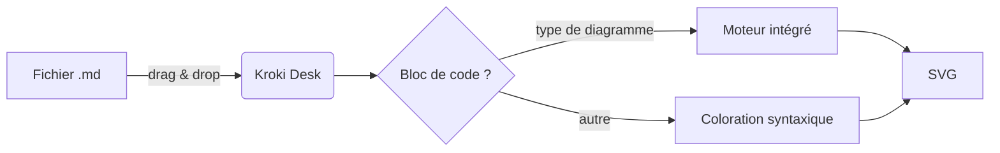
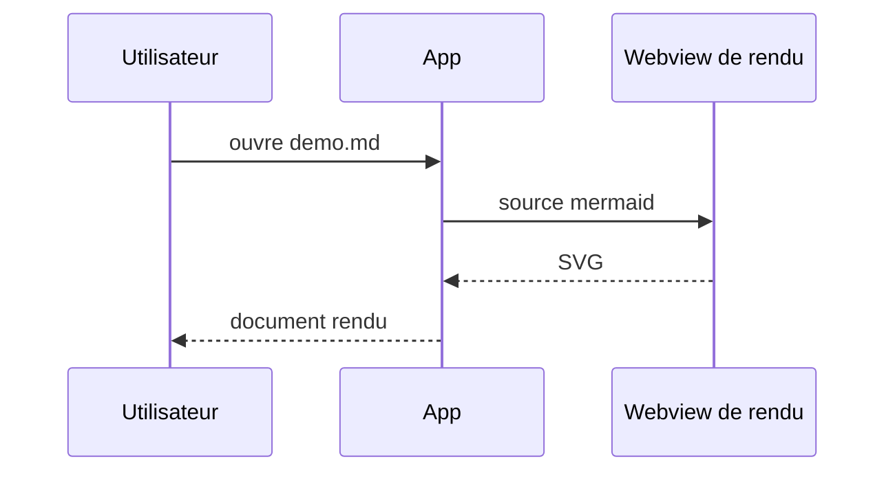
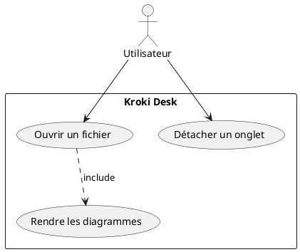
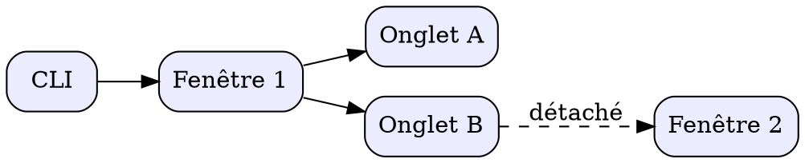

# Démo Kroki Desk

Document de démonstration : Markdown standard + diagrammes rendus par les
**moteurs intégrés** de l'application (aucun serveur requis).

## Sommaire

- [Markdown de base](#markdown-de-base)
- [Mermaid](#mermaid)
- [PlantUML](#plantuml)
- [GraphViz](#graphviz)
- [Autres moteurs](#autres-moteurs)

## Markdown de base

Du texte avec **gras**, *italique*, `code inline`, ~~barré~~ et un [lien](https://docs.kroki.io/kroki/).

> Une citation pour la forme.

| Moteur | Exécution | Types |
|------|-------|--------|
| mermaid, graphviz (WASM), vega… | webview dédiée | 7 types |
| svgbob, pikchr | natif Rust | 2 types |
| plantuml, c4plantuml | Java (si présent) | 2 types |

- [x] Rendu markdown
- [x] Diagrammes sans serveur
- [ ] Café

```python
def fib(n: int) -> int:
    """Fibonacci, sans prétention."""
    return n if n < 2 else fib(n - 1) + fib(n - 2)
```

## Mermaid





## PlantUML

Nécessite Java sur le poste (plantuml-mit.jar est embarqué dans l'application).



## GraphViz



## Autres moteurs

### Svgbob (ASCII art, natif)

```svgbob
   .---.     .---.
   | A +---->+ B |
   '---'     '-+-'
                |
                v
             .--+--.
             |  C  |
             '-----'
```

### Pikchr (natif)

```pikchr
box "Markdown" fit
arrow
box "Moteurs" fit
arrow
box "SVG" fit
```

### Nomnoml

```nomnoml
[Kroki Desk|
  [Fenêtre]->[Onglet]
  [Onglet]->[Document]
]
```

### WaveDrom (chronogramme)

```wavedrom
{ "signal": [
  { "name": "clk",  "wave": "p......" },
  { "name": "data", "wave": "x345x..", "data": ["A", "B", "C"] },
  { "name": "en",   "wave": "01...0." }
]}
```

### d2 (WASM officiel)

```d2
direction: right
md: Fichier .md
app: Kroki Desk
md -> app: drag & drop
app -> md: rendu
```

### dbml (schéma de base, rendu via graphviz)

```dbml
Table users {
  id int [pk]
  role_id int
}
Table roles {
  id int [pk]
  name varchar
}
Ref: users.role_id > roles.id
```

### Vega-Lite (graphique)

```vegalite
{
  "$schema": "https://vega.github.io/schema/vega-lite/v5.json",
  "description": "Un petit bar chart.",
  "data": {"values": [
    {"moteur": "intégré", "score": 9},
    {"moteur": "docker", "score": 4},
    {"moteur": "cloud", "score": 2}
  ]},
  "mark": "bar",
  "encoding": {
    "x": {"field": "moteur", "type": "nominal", "axis": {"labelAngle": 0}},
    "y": {"field": "score", "type": "quantitative"}
  }
}
```

### Bloc avec erreur volontaire

L'application doit afficher le diagnostic du moteur sans casser le reste de la page.

```mermaid
graph TD; A --> ;; erreur volontaire
```

### Type non intégré (message attendu)

```blockdiag
blockdiag { A -> B }
```

---

Fin de la démo. Modifiez ce fichier dans votre éditeur : la vue se met à jour automatiquement.
