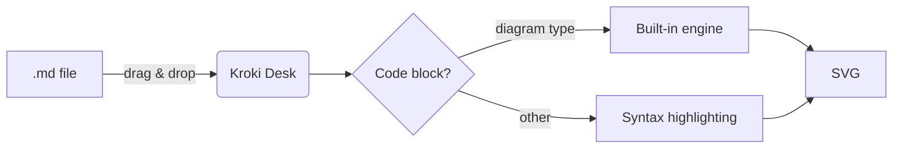
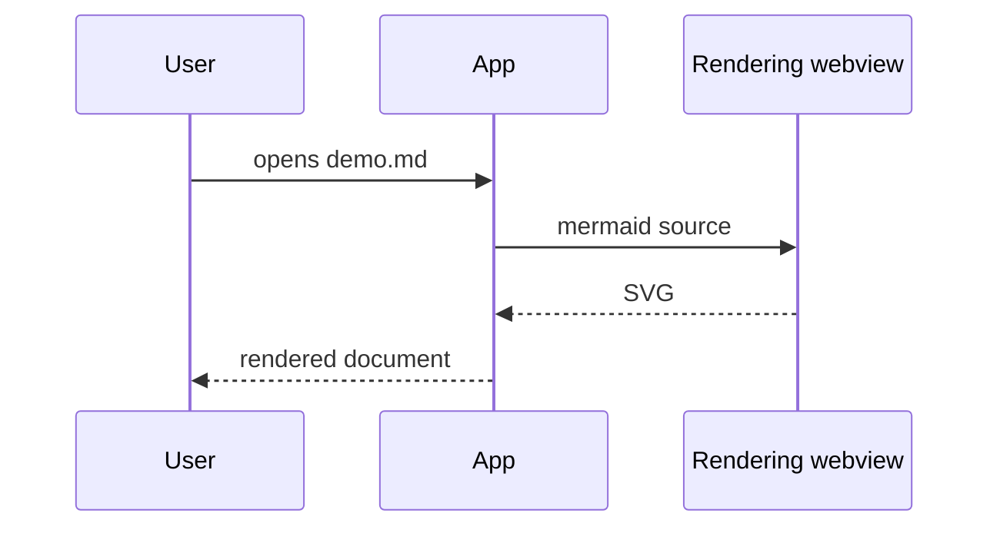
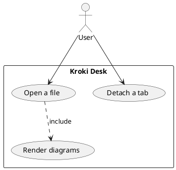
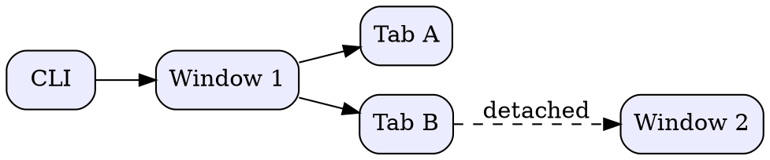

# Kroki Desk demo

Demo document: standard Markdown + diagrams rendered by the
**built-in engines** of the application (no server required).

## Contents

- [Basic Markdown](#basic-markdown)
- [Mermaid](#mermaid)
- [PlantUML](#plantuml)
- [GraphViz](#graphviz)
- [Other engines](#other-engines)

## Basic Markdown

Some text with **bold**, *italic*, `inline code`, ~~strikethrough~~ and a [link](https://docs.kroki.io/kroki/).

> A quote for good measure.

| Engine | Execution | Types |
|------|-------|--------|
| mermaid, graphviz (WASM), vega… | dedicated webview | 7 types |
| svgbob, pikchr | native Rust | 2 types |
| plantuml, c4plantuml | Java (if present) | 2 types |

- [x] Markdown rendering
- [x] Serverless diagrams
- [ ] Coffee

```python
def fib(n: int) -> int:
    """Fibonacci, unpretentious."""
    return n if n < 2 else fib(n - 1) + fib(n - 2)
```

## Mermaid





## PlantUML

Requires Java on the machine (plantuml-mit.jar is embedded in the application).



## GraphViz



## Other engines

### Svgbob (ASCII art, native)

```svgbob
   .---.     .---.
   | A +---->+ B |
   '---'     '-+-'
                |
                v
             .--+--.
             |  C  |
             '-----'
```

### Pikchr (native)

```pikchr
box "Markdown" fit
arrow
box "Engines" fit
arrow
box "SVG" fit
```

### Nomnoml

```nomnoml
[Kroki Desk|
  [Window]->[Tab]
  [Tab]->[Document]
]
```

### WaveDrom (timing diagram)

```wavedrom
{ "signal": [
  { "name": "clk",  "wave": "p......" },
  { "name": "data", "wave": "x345x..", "data": ["A", "B", "C"] },
  { "name": "en",   "wave": "01...0." }
]}
```

### d2 (official WASM)

```d2
direction: right
md: .md file
app: Kroki Desk
md -> app: drag & drop
app -> md: rendering
```

### dbml (database schema, rendered via graphviz)

```dbml
Table users {
  id int [pk]
  role_id int
}
Table roles {
  id int [pk]
  name varchar
}
Ref: users.role_id > roles.id
```

### Vega-Lite (chart)

```vegalite
{
  "$schema": "https://vega.github.io/schema/vega-lite/v5.json",
  "description": "A small bar chart.",
  "data": {"values": [
    {"engine": "built-in", "score": 9},
    {"engine": "docker", "score": 4},
    {"engine": "cloud", "score": 2}
  ]},
  "mark": "bar",
  "encoding": {
    "x": {"field": "engine", "type": "nominal", "axis": {"labelAngle": 0}},
    "y": {"field": "score", "type": "quantitative"}
  }
}
```

### Block with intentional error

The application must display the engine diagnostic without breaking the rest of the page.

```mermaid
graph TD; A --> ;; intentional error
```

### Unsupported type (expected message)

```blockdiag
blockdiag { A -> B }
```

---

End of the demo. Edit this file in your editor: the view updates automatically.
