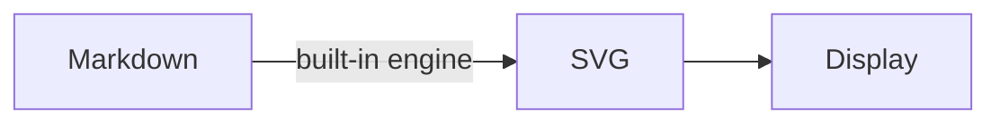
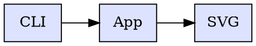
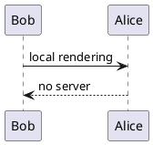

# Built-in engines test

## mermaid



## graphviz (WASM)



## plantuml (Java)



## svgbob (natif)

```svgbob
 .---.    .---.
 | A +--->+ B |
 '---'    '---'
```

## pikchr (natif)

```pikchr
box "Markdown" fit
arrow
box "SVG" fit
```

## nomnoml

```nomnoml
[Window]->[Tab]
[Tab]->[Document]
```

## vega-lite

```vegalite
{
  "$schema": "https://vega.github.io/schema/vega-lite/v5.json",
  "data": {"values": [{"x": "A", "y": 3}, {"x": "B", "y": 7}, {"x": "C", "y": 5}]},
  "mark": "bar",
  "encoding": {
    "x": {"field": "x", "type": "nominal"},
    "y": {"field": "y", "type": "quantitative"}
  }
}
```

## wavedrom

```wavedrom
{ "signal": [
  { "name": "clk",  "wave": "p....." },
  { "name": "data", "wave": "x345x.", "data": ["A", "B", "C"] }
]}
```

## bytefield

```bytefield
(defattrs :bg-green {:fill "#a0ffa0"})
(draw-column-headers)
(draw-box "Source" {:span 4 :borders #{:left :top :bottom}})
(draw-box "Port" {:span 2})
(draw-box 0 {:span 2})
(draw-gap "Payload")
(draw-bottom)
```

## c4plantuml

```c4plantuml
@startuml
!include <C4/C4_Context>
Person(user, "User")
System(app, "Kroki Desk", "Markdown viewer")
Rel(user, app, "opens files")
@enduml
```

## ditaa (Java)

```ditaa
+--------+   +---------+
| Client +-->| Server  |
+--------+   +----+----+
                  |
             +----v----+
             |   DB    |
             | {s}     |
             +---------+
```

## erd (→ graphviz)

```erd
title {label: "Registration"}

[Person]
*id
name
height
+location_id

[Location]
*id
city
state

Person *--1 Location
```

## excalidraw

Text rendered in a system font (handwriting fonts are not embedded).

```excalidraw
{"type":"excalidraw","version":2,"source":"kroki-desk","elements":[
  {"type":"rectangle","x":100,"y":100,"width":220,"height":90,"id":"r1","strokeColor":"#1e1e1e","backgroundColor":"#a5d8ff","fillStyle":"solid"},
  {"type":"text","x":130,"y":132,"width":160,"height":25,"id":"t1","text":"Hello Kroki","fontSize":20,"fontFamily":1,"strokeColor":"#1e1e1e"}
],"appState":{"viewBackgroundColor":"#ffffff"},"files":{}}
```

## Unsupported type (expected message)

```blockdiag
blockdiag { A -> B }
```
