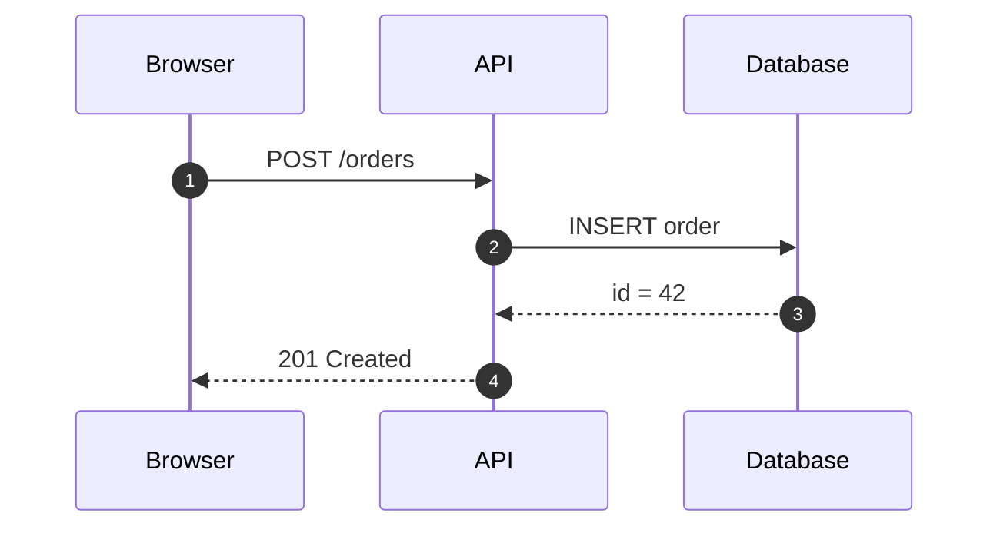
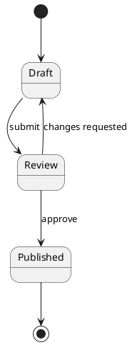
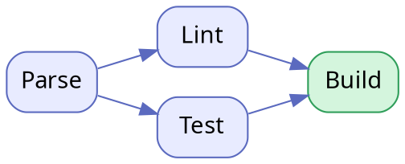

# Engine gallery







```d2
direction: right
user: User {shape: person}
app: Kroki Desk {
  md: Markdown
  eng: Engines
  md -> eng
}
svg: SVG {shape: page}
user -> app.md: opens
app.eng -> svg: renders
```

```bpmn
<?xml version="1.0" encoding="UTF-8"?>
<bpmn:definitions xmlns:bpmn="http://www.omg.org/spec/BPMN/20100524/MODEL" xmlns:bpmndi="http://www.omg.org/spec/BPMN/20100524/DI" xmlns:dc="http://www.omg.org/spec/DD/20100524/DC" xmlns:di="http://www.omg.org/spec/DD/20100524/DI" id="Defs_1" targetNamespace="http://bpmn.io/schema/bpmn">
  <bpmn:process id="P" isExecutable="false">
    <bpmn:startEvent id="S" name="Order received"/>
    <bpmn:task id="T1" name="Check stock"/>
    <bpmn:exclusiveGateway id="G" name="In stock?"/>
    <bpmn:task id="T2" name="Ship"/>
    <bpmn:task id="T3" name="Backorder"/>
    <bpmn:endEvent id="E" name="Done"/>
    <bpmn:sequenceFlow id="F1" sourceRef="S" targetRef="T1"/>
    <bpmn:sequenceFlow id="F2" sourceRef="T1" targetRef="G"/>
    <bpmn:sequenceFlow id="F3" sourceRef="G" targetRef="T2"/>
    <bpmn:sequenceFlow id="F4" sourceRef="G" targetRef="T3"/>
    <bpmn:sequenceFlow id="F5" sourceRef="T2" targetRef="E"/>
  </bpmn:process>
  <bpmndi:BPMNDiagram id="D">
    <bpmndi:BPMNPlane id="PL" bpmnElement="P">
      <bpmndi:BPMNShape id="S_di" bpmnElement="S"><dc:Bounds x="100" y="102" width="36" height="36"/></bpmndi:BPMNShape>
      <bpmndi:BPMNShape id="T1_di" bpmnElement="T1"><dc:Bounds x="180" y="80" width="100" height="80"/></bpmndi:BPMNShape>
      <bpmndi:BPMNShape id="G_di" bpmnElement="G" isMarkerVisible="true"><dc:Bounds x="325" y="95" width="50" height="50"/></bpmndi:BPMNShape>
      <bpmndi:BPMNShape id="T2_di" bpmnElement="T2"><dc:Bounds x="420" y="80" width="100" height="80"/></bpmndi:BPMNShape>
      <bpmndi:BPMNShape id="T3_di" bpmnElement="T3"><dc:Bounds x="420" y="200" width="100" height="80"/></bpmndi:BPMNShape>
      <bpmndi:BPMNShape id="E_di" bpmnElement="E"><dc:Bounds x="572" y="102" width="36" height="36"/></bpmndi:BPMNShape>
      <bpmndi:BPMNEdge id="F1_di" bpmnElement="F1"><di:waypoint x="136" y="120"/><di:waypoint x="180" y="120"/></bpmndi:BPMNEdge>
      <bpmndi:BPMNEdge id="F2_di" bpmnElement="F2"><di:waypoint x="280" y="120"/><di:waypoint x="325" y="120"/></bpmndi:BPMNEdge>
      <bpmndi:BPMNEdge id="F3_di" bpmnElement="F3"><di:waypoint x="375" y="120"/><di:waypoint x="420" y="120"/></bpmndi:BPMNEdge>
      <bpmndi:BPMNEdge id="F4_di" bpmnElement="F4"><di:waypoint x="350" y="145"/><di:waypoint x="350" y="240"/><di:waypoint x="420" y="240"/></bpmndi:BPMNEdge>
      <bpmndi:BPMNEdge id="F5_di" bpmnElement="F5"><di:waypoint x="520" y="120"/><di:waypoint x="572" y="120"/></bpmndi:BPMNEdge>
    </bpmndi:BPMNPlane>
  </bpmndi:BPMNDiagram>
</bpmn:definitions>
```

```vegalite
{
  "$schema": "https://vega.github.io/schema/vega-lite/v5.json",
  "width": 320, "height": 180,
  "data": {"values": [
    {"m": "Jan", "v": 28, "s": "2025"}, {"m": "Feb", "v": 55, "s": "2025"}, {"m": "Mar", "v": 43, "s": "2025"}, {"m": "Apr", "v": 91, "s": "2025"},
    {"m": "Jan", "v": 35, "s": "2026"}, {"m": "Feb", "v": 62, "s": "2026"}, {"m": "Mar", "v": 70, "s": "2026"}, {"m": "Apr", "v": 104, "s": "2026"}
  ]},
  "mark": {"type": "bar", "cornerRadiusEnd": 3},
  "encoding": {
    "x": {"field": "m", "type": "ordinal", "sort": null, "title": null},
    "xOffset": {"field": "s"},
    "y": {"field": "v", "type": "quantitative", "title": "Orders"},
    "color": {"field": "s", "title": null, "legend": {"orient": "top"}}
  }
}
```

```c4plantuml
@startuml
!include <C4/C4_Container>
Person(user, "Writer", "Writes Markdown")
System_Boundary(kd, "Kroki Desk") {
  Container(ui, "Viewer", "WebView2", "Renders documents")
  Container(eng, "Engines", "WASM / Rust / JVM", "Diagram rendering")
}
Rel(user, ui, "Opens .md")
Rel(ui, eng, "Renders fences")
@enduml
```

```dbml
Table customers {
  id int [pk]
  email varchar
}
Table orders {
  id int [pk]
  customer_id int
  total decimal
}
Table items {
  order_id int
  sku varchar
  qty int
}
Ref: orders.customer_id > customers.id
Ref: items.order_id > orders.id
```

```wavedrom
{ "signal": [
  { "name": "clk",   "wave": "p.......|.." },
  { "name": "req",   "wave": "0.1..0..|.." },
  { "name": "addr",  "wave": "x.3..x..|..", "data": ["0x2F"] },
  { "name": "ack",   "wave": "0...1.0.|.." },
  { "name": "data",  "wave": "x...4.x.|..", "data": ["DATA"] }
]}
```

```svgbob
    .-------.        .---------.        .-----.
    | .md   |------->| Kroki   |------->| SVG |
    '-------'  open  |  Desk   | render '-----'
                     '----+----'
                          |  ^
                          v  |  live reload
                     .----+----.
                     |  disk   |
                     '---------'
```

```tikz
\begin{tikzpicture}[scale=1.1]
  \draw[->, thick] (-0.3,0) -- (4.3,0) node[right] {$x$};
  \draw[->, thick] (0,-1.3) -- (0,1.5) node[above] {$y$};
  \draw[domain=0:4, smooth, variable=\x, blue, very thick, samples=80] plot ({\x}, {sin(deg(2*\x))*exp(-0.35*\x)});
  \draw[domain=0:4, dashed, red] plot ({\x}, {exp(-0.35*\x)});
  \node[red] at (3.2,0.6) {$e^{-0.35x}$};
\end{tikzpicture}
```

```excalidraw
{"type":"excalidraw","version":2,"source":"kroki-desk","elements":[
  {"type":"rectangle","x":0,"y":0,"width":180,"height":70,"id":"r1","strokeColor":"#1e1e1e","backgroundColor":"#a5d8ff","fillStyle":"hachure","roughness":1,"seed":1},
  {"type":"text","x":38,"y":22,"width":110,"height":25,"id":"t1","text":"Idea","fontSize":20,"fontFamily":1,"strokeColor":"#1e1e1e","seed":2},
  {"type":"arrow","x":185,"y":35,"width":110,"height":0,"id":"a1","points":[[0,0],[110,0]],"strokeColor":"#1e1e1e","endArrowhead":"arrow","roughness":1,"seed":3},
  {"type":"ellipse","x":300,"y":-5,"width":170,"height":80,"id":"e1","strokeColor":"#1e1e1e","backgroundColor":"#b2f2bb","fillStyle":"hachure","roughness":1,"seed":4},
  {"type":"text","x":345,"y":22,"width":90,"height":25,"id":"t2","text":"Sketch","fontSize":20,"fontFamily":1,"strokeColor":"#1e1e1e","seed":5}
],"appState":{"viewBackgroundColor":"#ffffff"},"files":{}}
```
