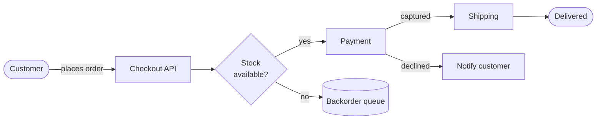

# Checkout service — design notes

Everything below is rendered **offline** by the engines embedded in Kroki Desk:
no server, no Docker, no network.



The expected latency of the pipeline is the sum of its stages,

$$
\mathbb{E}[T] = \sum_{i=1}^{n} \frac{1}{\mu_i - \lambda}, \qquad \lambda < \min_i \mu_i
$$

| Stage | p50 | p99 | Owner |
| --- | ---: | ---: | --- |
| Checkout API | 12 ms | 48 ms | `@team-web` |
| Payment | 180 ms | 900 ms | `@team-pay` |
| Shipping | 35 ms | 120 ms | `@team-ops` |

```sql
SELECT order_id, status FROM orders WHERE created_at > now() - interval '1 day';
```
