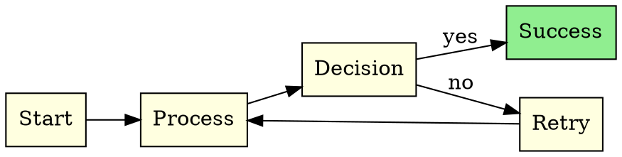
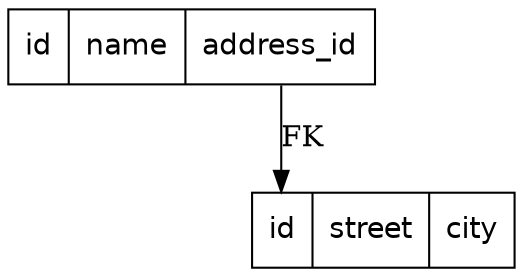
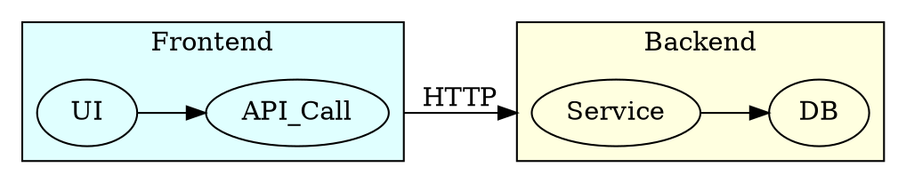
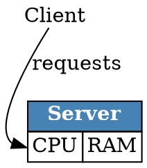

# GraphViz

**API ID**: `graphviz` | **Output**: SVG, PNG, JPEG, PDF | **Best for**: Dependency trees, state machines, flowcharts, org charts, network graphs

## Syntax DOT

```
[ strict ] (graph | digraph) [ ID ] { stmt_list }
```

- `digraph` = directed (`->`), `graph` = undirected (`--`)
- `strict` = forbids multi-edges between the same nodes
- Chaining: `A -> B -> C` creates sequential edges
- Comments: `/* */` and `//`
- Default attributes: `node [shape=box]; edge [color=gray]` (affect the following nodes/edges)

### Nodes

```dot
NodeID [attr=val, attr2=val2]
```

| Attribute | Key values | Default |
|---|---|---|
| `shape` | box, circle, ellipse, diamond, record, Mrecord, plaintext, plain, point, doublecircle, polygon, cylinder, note, folder, star, tab, component | `ellipse` |
| `label` | text or HTML-like | node name |
| `color` | X11/hex | `black` |
| `fillcolor` | X11/hex | `lightgrey` |
| `fontcolor` | X11/hex | `black` |
| `fontname` | font name | — |
| `fontsize` | points | `14.0` |
| `style` | filled, dashed, dotted, bold, rounded, solid | — |
| `penwidth` | double | `1.0` |
| `width`/`height` | inches | `0.75`/`0.5` |

### Edges

| Attribute | Key values | Default |
|---|---|---|
| `label` | text | — |
| `color` | X11/hex | `black` |
| `style` | solid, dashed, dotted, bold, tapered | — |
| `arrowhead` | normal, vee, dot, box, diamond, crow, inv, tee, none | `normal` |
| `arrowtail` | (same values) | `normal` |
| `dir` | forward, back, both, none | `forward` |
| `weight` | int/double (layout priority) | `1` |
| `penwidth` | double | `1.0` |
| `constraint` | bool (influences the rank) | `true` |

### Graph

| Attribute | Values | Note |
|---|---|---|
| `rankdir` | TB, LR, BT, RL | dot only |
| `bgcolor` | X11/hex | canvas background |
| `splines` | true, false, ortho, curved, polyline | edge routing |
| `nodesep` | inches | horizontal spacing (dot) |
| `ranksep` | inches | spacing between ranks (dot) |
| `compound` | bool | edges to clusters |
| `concentrate` | bool | merges parallel edges |
| `overlap` | true, false, scale | overlap handling |
| `label` | text | graph title |

### Clusters

```dot
subgraph cluster_name {
  label="Title";
  color=blue; style=filled; fillcolor=lightgrey;
  A; B; C;
}
```

- The name **must** start with `cluster_` to trigger the boxed rendering
- `compound=true` is required on the graph for cluster-to-cluster edges
- `lhead`/`ltail` on an edge to point to a cluster (`compound=true`)

### Record shapes

```dot
node [shape=record]
R [label="<f0> left | middle | <f2> right"]
S [label="{ top | { <f1> left | right } | bottom }"]
// Port : R:f0 -> S:f1
```

- `|` = field separator (horizontal by default)
- `{ }` = flips the orientation (vertical/horizontal)
- `<portname>` = anchor point for edges
- `Mrecord` = rounded corners

### HTML-like labels

```dot
N [shape=plain, label=<
  <TABLE BORDER="0" CELLBORDER="1" CELLSPACING="0">
    <TR><TD BGCOLOR="lightblue"><B>Title</B></TD></TR>
    <TR><TD PORT="p1">field</TD></TR>
  </TABLE>
>]
```

- Delimited by `< >` instead of `" "`
- Tags : `TABLE`, `TR`, `TD`, `B`, `I`, `U`, `FONT`, `BR/`, `IMG`
- `PORT="name"` on `<TD>` for anchor points

### Ports / compass points

```dot
A:e -> B:w          // directional anchors
A:port1:n -> B:p2:s // named port + direction
```

Compass points: `n ne e se s sw w nw c _`

## Kroki options

| Option | Values | Note |
|---|---|---|
| `layout` | dot, neato, fdp, sfdp, twopi, circo | rendering engine |
| `scale` | double | scale (default `72.0`, pts→inches) |
| `graph-attribute-{name}` | value | overrides a graph attribute |
| `node-attribute-{name}` | value | overrides a global node attribute |
| `edge-attribute-{name}` | value | overrides a global edge attribute |

**Layout engines :**
- `dot`: hierarchical (DAGs, flowcharts) — default
- `neato`: spring model (undirected networks)
- `fdp`: force-directed (large sparse graphs)
- `sfdp`: scalable fdp (very large graphs)
- `twopi`: radial (centered tree)
- `circo`: circular (cyclic graphs)
- `osage`: array/patchwork (clustering)

## Gotchas

- `->` in `digraph`, `--` in `graph` — do not mix
- `shape=record`: `|` and `<>` in `label` = meta-characters, escape with `\` if literal
- HTML-like label: use `< >` rather than `" "`; strict XHTML required
- `cluster_` prefix is mandatory, not `subgraph_cluster`
- `compound=true` **forgotten** = edges to clusters silently ignored
- Default attributes (`node [...]`) only affect nodes declared **afterwards**
- `strict digraph` removes duplicate edges — beware of intentional multi-edges
- Colors: X11 names (`lightblue`), hex (`"#ff0000"`), or HSV scheme — quotes required for hex
- `fontname` must match a font installed on the Kroki server

## Examples

### Flowchart with cluster



### Record / table



### Clusters + compound



### HTML-like label


