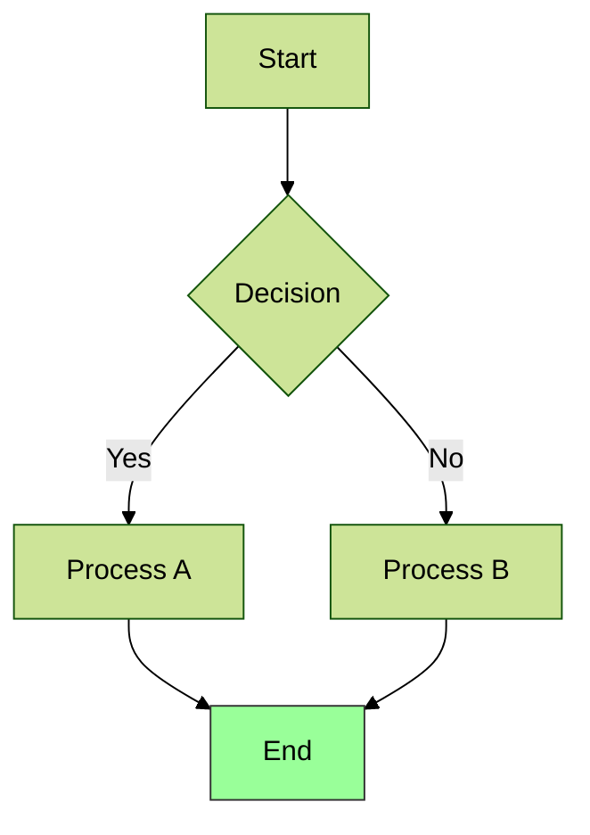
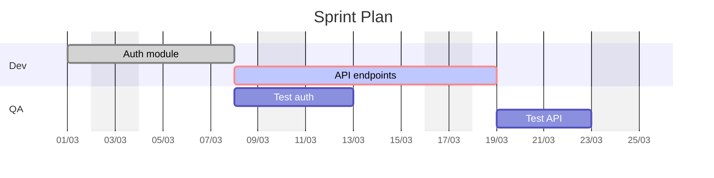
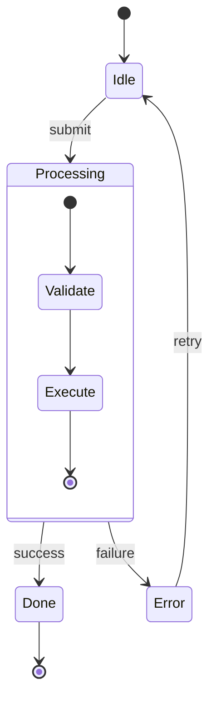

# Mermaid

**API ID**: `mermaid` | **Output**: SVG, PNG | **Best for**: Quick diagrams in markdown, GitHub/GitLab native rendering

## Syntax

### Diagram types (opening keyword)

| Type | Keyword | Notes |
|---|---|---|
| Flowchart | `flowchart TD` / `graph TD` | directions: TB TD BT LR RL |
| Sequence | `sequenceDiagram` | |
| Class | `classDiagram` | |
| State | `stateDiagram-v2` | prefer v2 over v1 |
| ER | `erDiagram` | |
| Gantt | `gantt` | |
| Pie | `pie title X` | |
| Journey | `journey` | user story map |
| Git | `gitGraph` | |
| Mindmap | `mindmap` | |
| Timeline | `timeline` | |
| Quadrant | `quadrantChart` | |
| Sankey | `sankey-beta` | |
| XY Chart | `xychart-beta` | bar/line |
| Block | `block-beta` | |
| Requirement | `requirementDiagram` | |
| C4 | `C4Context` / `C4Container` | experimental |
| ZenUML | `zenuml` | |
| Packet | `packet-beta` | network packets |
| Kanban | `kanban` | |
| Architecture | `architecture-beta` | |

### Flowchart

```
flowchart LR
    A[Rectangle] --> B(Rounded) --> C{Diamond}
    C -->|Yes| D[(Database)]
    C -->|No| E((Circle))
    subgraph SG [Group]
        F[[Subroutine]] -.-> G>Asymmetric]
    end
```

Node shapes: `[rect]` `(round)` `([stadium])` `[[subroutine]]` `[(cylinder)]` `((circle))` `{diamond}` `{{hexagon}}` `>asymmetric]`
Edges: `-->` `---` `-.->` `==>` `--o` `--x` `~~~` (invisible)
Labels on edges: `-->|text|` or `-- text -->`
Style: `style nodeId fill:#f9f,stroke:#333` | `classDef name fill:#f9f` | `class id1,id2 name`
Subgraph: `subgraph id [title]` ... `end` | direction override: `direction LR` inside subgraph

### Sequence diagram

```
sequenceDiagram
    autonumber
    participant A as Alice
    actor B as Bob
    A->>B: Request
    activate B
    B-->>A: Response
    deactivate B
    loop Retry
        A->>B: Retry
    end
    alt Success
        B-->>A: OK
    else Failure
        B-->>A: Error
    end
    opt Optional
        A->>A: Self-call
    end
    Note right of A: annotation
    par Parallel
        A->>B: msg1
    and
        A->>B: msg2
    end
```

Arrow types: `->>` `-->>` `->` `-->` `-x` `--x` `-)` `--)`
Blocks: `loop/end` `alt/else/end` `opt/end` `par/and/end` `critical/option/end` `break/end`
Special: `autonumber` | `rect rgb(255,0,0)` ... `end` (background)

### State diagram

```
stateDiagram-v2
    direction LR
    [*] --> Idle
    Idle --> Running : start
    Running --> [*] : stop
    Running --> Error
    state Running {
        [*] --> Step1
        Step1 --> Step2
        Step2 --> [*]
    }
    state Choice <<choice>>
    Running --> Choice
    Choice --> Fast : fast
    Choice --> Slow : slow
    note right of Idle: This is idle
```

Special: `[*]` start/end | `<<choice>>` `<<fork>>` `<<join>>` | `--` concurrency separator | `direction TB|LR`

### Gantt

```
gantt
    title Project
    dateFormat YYYY-MM-DD
    axisFormat %m/%d
    excludes weekends
    section Phase 1
        Task A      : done, t1, 2024-01-01, 7d
        Task B      : active, crit, t2, after t1, 5d
        Milestone   : milestone, m1, 2024-01-15, 0d
    section Phase 2
        Task C      : t3, after t2, 10d
```

Task status tags (combinable): `done` `active` `crit` `milestone`
Date ref: `after taskId` | duration: `Nd` `Nw`

### Class diagram

```
classDiagram
    class Animal {
        +String name
        +int age
        +makeSound() void
    }
    class Dog {
        +fetch() void
    }
    Animal <|-- Dog : inherits
    Dog "1" --> "*" Bone : has
```

Relations: `<|--` inherit | `*--` composition | `o--` aggregation | `-->` association | `--` link | `..>` dependency | `..|>` realization
Visibility: `+` public `-` private `#` protected `~` package
Annotations: `<<Interface>>` `<<Abstract>>` `<<Service>>` `<<Enumeration>>`

### ER diagram

```
erDiagram
    CUSTOMER ||--o{ ORDER : places
    ORDER ||--|{ ITEM : contains
    CUSTOMER {
        string name
        int id PK
    }
```

Cardinality: `|o` zero-or-one `||` exactly-one `}o` zero-or-more `}|` one-or-more

### Other types (compact)

**Pie**: `pie title X` + `"Label" : value`
**Mindmap**: root((center)) then indent levels, shapes `((circle))` `[square]` `(round)`
**Timeline**: `section Year` + `Event : detail`
**Quadrant**: `quadrantChart` + `x-axis Low --> High` + `y-axis` + `quadrant-1 name` + `Point : [x, y]`
**Journey**: `title X` + `section Phase` + `Task: score: Actor1, Actor2`

## Config / Init directive

```
%%{init: {"theme": "forest", "themeVariables": {"primaryColor": "#ff0000"}, "flowchart": {"curve": "basis"}}}%%
flowchart TD
    ...
```

**Themes**: `default` `dark` `forest` `neutral` `base` (only `base` is customizable via `themeVariables`)
**themeVariables** (base theme): `primaryColor` `primaryTextColor` `primaryBorderColor` `lineColor` `background` `fontSize` — hex values only, no color names
**Common config keys**: `theme` `fontFamily` `fontSize` `logLevel` `securityLevel` `startOnLoad`
**Diagram-specific**: `flowchart.curve` (basis|linear|step) | `sequence.showSequenceNumbers` | `gantt.useWidth`

Frontmatter alternative (v10.5.0+, preferred over init):
```
---
config:
  theme: dark
---
flowchart TD
    ...
```

## Options (Kroki)

- Config passed as Kroki query params in kebab-case, e.g. `?theme=forest`
- No special wrapper: diagram code starts directly with type keyword
- Comments: `%% comment`

## Gotchas

- **Special chars in labels**: wrap in quotes `A["text with (parens)"]` | forbidden: smart quotes `" "` em-dash `—` unicode arrows `→` non-breaking spaces
- **Node IDs**: `[A-Za-z0-9_]` only — no spaces, hyphens, or dots
- **`graph` vs `flowchart`**: prefer `flowchart` (newer, more features); `graph TD` still valid
- **stateDiagram-v2**: always use v2, v1 has limited features
- **`->>` vs `->`** in sequence: `>>` = arrowhead both ends, `>` = open end
- **Gantt date**: `dateFormat` must match task date strings exactly
- **`%%{init}%%` deprecated**: use frontmatter YAML block instead (v10.5.0+)
- **subgraph IDs**: no spaces; use `subgraph id [Display Name]` pattern
- **Long labels**: use `\n` for line breaks inside node labels: `A["line1<br/>line2"]`
- **classDiagram generics**: use `~T~` for generics, not `<T>`

## Examples

### Flowchart with styling


### Gantt


### State machine

