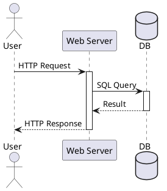
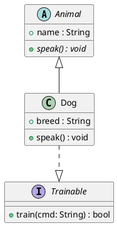
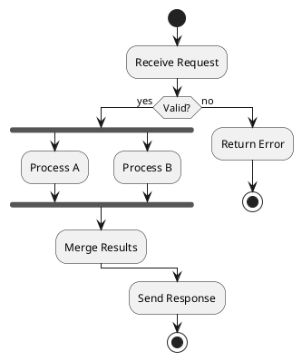

# PlantUML

> ☕ **Requires a JRE/JDK on the machine.** Kroki Desk embeds the jar but shells out
> to `java`; with no Java installed the block errors out ("nécessite Java, qui n'a pas
> été trouvé sur ce poste", i.e. "requires Java, which was not found on this machine"). Check with `java -version` — `/v1/health` lists this type
> even when Java is missing. Fallback without Java: `mermaid` or `d2`.

**API ID**: `plantuml` | **Output**: SVG, PNG, PDF, TXT | **Best for**: Full UML suite, mind maps, WBS, Gantt, JSON/YAML visualization, wireframes

## Syntax

### Wrap tags (required)
`@startuml`/`@enduml` · `@startmindmap`/`@endmindmap` · `@startwbs`/`@endwbs` · `@startgantt`/`@endgantt` · `@startsalt`/`@endsalt` · `@startjson`/`@endjson` · `@startyaml`/`@endyaml` · `@startditaa`/`@endditaa`

### Common (all types)
`title`/`end title` · `header`/`footer` (left/center/right) · `legend`/`end legend` · `caption` · `mainframe` · `note` · `scale 1.5` | `scale 200 width` · `left to right direction` · `top to bottom direction` · `hide` · `show` · `remove` · `together` · `' comment` · `/' block comment '/`

### Sequence diagram
Participants: `participant` `actor` `boundary` `control` `entity` `database` `collections` `queue` + `as` alias + `order N`
Arrows: `->` `-->` `<-` `<--` `->>` `-->>` `->x` `->o` `<->` `[->` `->]` `o->o`
Activation: `activate` `deactivate` `destroy` `create` `return` `autoactivate` · shortcuts: `++` `--` `**` `!!`
Grouping: `alt`/`else`/`end` · `opt` · `loop` · `par` · `break` · `critical` · `group` · `ref over`
Extras: `autonumber` (start inc format) · `autonumber stop/resume` · `==divider==` · `...delay...` · `|||` · `newpage` · `box`/`end box` · `note left/right/over` · `hnote` `rnote` · `hide footbox`

### Class diagram
Types: `class` `abstract class` `abstract` `interface` `enum` `annotation` `dataclass` `record` `struct` `protocol` `exception` `entity`
Relations: `<|--` (extends) · `<|..` (implements) · `*--` (composition) · `o--` (aggregation) · `-->` (dependency) · `..>` (weak dep) · `--` `..` (association)
Members: `-` `#` `~` `+` (visibility) · `{field}` `{method}` `{static}` `{abstract}` · `<<stereotype>>`
Control: `hide members` · `hide empty members` · `hide circle` · `package` · `namespace` · `together` · `note on link`

### Activity diagram (new syntax)
Flow: `:action;` · `start` `stop` `end` `kill` `detach`
Conditions: `if (cond) then (yes)` / `elseif` / `else (no)` / `endif` · `switch`/`case`/`endswitch`
Loops: `while (cond) is (yes)` / `endwhile` · `repeat` / `backward :x;` / `repeat while (cond)`  · `break`
Parallel: `fork` / `fork again` / `end fork` · `end merge` · `split` / `split again` / `end split`
Containers: `partition` `group` `package` `rectangle` `card` · swimlanes via `|lane|`
Notes: `note left/right` · `floating note`

### State diagram
`[*] --> State` · `state "Label" as S` · `state S { }` (composite) · `--` `||` (concurrent regions)
Stereotypes: `<<fork>>` `<<join>>` `<<choice>>` `<<start>>` `<<end>>` `<<history>>` `<<history*>>` `<<entryPoint>>` `<<exitPoint>>`
Directional arrows: `-up->` `-down->` `-left->` `-right->`
Extras: `hide empty description` · `note on link` · `note left/right/top/bottom of`

### Use case diagram
`actor` · `usecase` `usecase "long" as UC1` · `-->` `..>` · `(use case)` `(uc)` · `<<include>>` `<<extend>>` · `rectangle` `package` `node`

### Component / Deployment diagram
`component` `[component]` · `interface` `()interface` · `package` `node` `cloud` `database` `storage` `frame` `folder` `rectangle` `agent` `artifact` `boundary` `card` `collections` `control` `entity` `file` `hexagon` `label` `person` `queue` `stack` · `port` `portin` `portout` · `allowmixing`

### Object diagram
`object "Name" as O { field = value }` · relations same as class · `map "Name" as M { key => value }`

### Timing diagram
Types: `concise` `robust` `binary` `clock` `analog` `rectangle`
Time: `@N` absolute · `@+N` relative · `:anchor` as reference
State: `Signal is State` · `->` messages · `highlight T1 to T2 : label` · `note top/bottom of`

### MindMap / WBS
MindMap: `*` `**` etc. (OrgMode) OR `+`/`-` (right/left) OR markdown `#`
WBS: same `+`/`-`/`*` hierarchy
Nodes: `[#color]` inline color · `_` suffix = no box · `:multiline\ncontent;` · `<<style>>`

### Gantt
`[Task] lasts N days` · `[Task] starts YYYY-MM-DD` · `[Task] starts at [Other]'s end` · `[Task] ends YYYY-MM-DD` · `[Task] is N% completed` · `[T2] starts at [T1]'s end` · `milestone` · `Project starts` · `saturday are closed` · `sunday are closed` · `[Task] is colored in Lime/Red` · `printscale daily|weekly|monthly`

### Network (nwdiag)
`@startuml` + `nwdiag {` · `network name { address="x.x.x.x/x" }` · `group name { color="#abc"; server1; server2 }`

### Salt (wireframe)
Widgets: `[button]` `"input"` `^dropdown^` `()radio` `[]check` `{*}` (scroll frame) · `{+}` (tab) · `{#}` (grid) · `{T}` (tree) · `{-}` separator · `<&icon>` (OpenIconic)
Layout: `{` columns `}` · `{/` vertical `/}` · `|` cell separator

### JSON / YAML
`@startjson` / `@startyaml` then raw JSON or YAML content. Highlight keys with `#highlight "path"`.

### Creole markup (in labels/notes)
`**bold**` `//italic//` `--strike--` `__underline__` `""monospace""` · `\n` newline · `<b>` `<i>` `<color:red>` `<size:N>` · `` · `[[url label]]` · `{scale=0.5}` · lists with `*` `-` `#`

## Options (Kroki)

- `theme`: amiga, blueprint, cerulean, cyborg, hacker, mars, materia, metal, minty, plain, reddress-darkblue, reddress-darkgreen, reddress-darkorange, reddress-darkred, reddress-lightblue, reddress-lightgreen, reddress-lightorange, reddress-lightred, sandstone, silver, sketchy, sketchy-outline, spacelab, superhero, toy, united, vibrant
- `no-metadata`: exclude source from SVG/PNG metadata

## Preprocessor

```
!$var = "value"          ' define variable
!$var ?= "default"       ' assign if undefined
!if ($var == "x") ... !else ... !endif
!while ($i < 5) ... !endwhile
!function $fn($a, $b="def") ... !return $result !endfunction
!procedure $proc($a) ... !endprocedure
!include file.puml        ' include file (once by default)
!include_many             ' allow multiple inclusions
!includesub file!SECTION  ' include named sub-section
!startsub NAME / !endsub  ' mark includable section
!theme materia            ' apply theme (BEFORE !include)
!log message              ' debug output
!assert $cond : "msg"
```

Built-in functions: `%date()` `%get_all_theme()` `%get_all_stdlib()` `%random()` `%boolval()` `%splitstr()` `%true()` `%false()` `%strlen()` `%substr()` `%intval()`

Legacy (deprecated): `!define` → use `!function` · `!definelong` → use `!procedure`

## Styling

### skinparam (legacy, still functional)
```
skinparam backgroundColor transparent
skinparam monochrome true          ' or reverse
skinparam shadowing false
skinparam defaultFontName Helvetica
skinparam sequenceMessageAlign center
skinparam ClassName {
  BackgroundColor #PaleBlue
  BorderColor Navy
  FontColor #333
}
```

### style/CSS (preferred, newer)
```
<style>
sequenceDiagram {
  BackgroundColor white
  actor { FontColor red }
}
classDiagram { FontSize 12 }
</style>
```
Properties: `BackgroundColor` `FontColor` `LineColor` `LineStyle` `FontSize` `FontName` `RoundCorner` `Padding` `Margin`

## Gotchas

- Missing `@startuml`/`@enduml` → blank output, no error
- Wrong start tag for type: mindmap needs `@startmindmap`, not `@startuml`
- `!theme` must come BEFORE `!include` in stdlib-based diagrams
- Name collisions: participant named same as keyword (quote with `"`)
- Arrow direction `->` vs `-->`: solid vs dashed, not "left vs right"
- Activity: old syntax (dashes) vs new syntax (`:action;`) — don't mix
- `left to right direction` changes sequence diagram layout unexpectedly
- Class diagram: `<|--` direction matters (child `--|>` parent OR parent `<|--` child)
- Gantt: dates must match `Project starts` format (default YYYY-MM-DD)
- Long labels: use `as` alias to avoid repeating verbose names

## Examples

### Sequence diagram


### Class diagram


### Activity diagram

